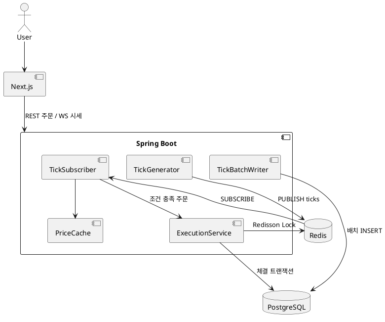

# TickLock 기획서

> 실시간 시세 수집 + 동시성 보장 자동 체결 엔진 (개인 포트폴리오 / 학습용)
> 원칙: **작게 시작 → 돌아가게 → 측정 → 개선**. 폴더/코드는 공부하며 읽기 쉽게 단순하게 유지한다.

---

## 0. 먼저 정리: 네가 물어본 것들

### Q1. 테이블에 외래키(FK)를 꼭 걸어야 하나?
- **돈이 오가는 테이블(`wallets`, `trigger_orders`, `executions`, `holdings`)은 건다.** 이 규모(초당 수천 건 이하)에서 FK 비용은 무시 가능하고, "고아 데이터"를 DB가 막아주는 안전망이다.
- **시세 로그(`price_ticks`)는 안 건다.** 초당 1,000건 INSERT 되는 테이블에 FK 검사를 붙이면 쓸데없는 비용이고, 잃어도 치명적이지 않다.
- 삭제 규칙은 전부 `ON DELETE RESTRICT`. 금융 데이터는 연쇄 삭제(CASCADE)하지 않는다.
- 면접 포인트: "FK는 정합성 필요도에 따라 선택적으로 적용했다."

### Q2. AWS를 꼭 써야 하나? (처음이라 걱정)
**처음엔 쓰지 않는다.** Docker Compose로 로컬에서 전부 돌린다. AWS는 3단계로 나눠 늦게 붙인다.

| 단계 | 환경 | 목적 | 대략 비용 |
|---|---|---|---|
| 1 | 내 PC + Docker Compose | 개발/부하테스트 전부 | 0원 |
| 2 | EC2 1대 + Docker Compose (그대로 올림) | "배포해봤다" 경험, URL 공유 | 월 1~2만원대 (프리티어면 더 낮음) |
| 3 (선택) | RDS(PostgreSQL) + ElastiCache(Redis) + 프론트는 Vercel | 관리형 서비스 경험 | 월 5만원+ → **쓸 때만 켜고 끈다** |

AWS 처음 쓸 때 필수 안전장치: ① **Billing Alarm(예산 알림) 먼저 설정** ② 루트 계정 말고 IAM 사용자 ③ 안 쓰면 인스턴스 중지/삭제.
→ 단계 2 시작할 때 같이 한 단계씩 안내해줄 수 있다.

### Q3. Matt Pocock Skills 설정은 내가 해야 하나?
**네가 직접 설치해야 한다.** (외부에서 파일을 내려받는 작업이라 내가 임의로 실행하지 않는다.) 터미널에서:
```bash
npx skills@latest add mattpocock/skills
```
설치 후 Claude Code 안에서 `/setup-matt-pocock-skills` 실행. 자세한 내용은 문서 말미 "부록 A".

---

## 1. 프로젝트 개요

| 항목 | 내용 |
|---|---|
| 목적 | 대량 시세 유입 처리 + 동시성(Race Condition) 문제 해결 경험을 보여주는 포트폴리오 |
| 핵심 가치 | ① 초당 1,000건+ 시세를 DB 병목 없이 처리 ② 동시 주문에도 잔액 정합성 보장 ③ 중복 이벤트에도 체결은 정확히 1번 |
| 스택 | Next.js(App Router)+TS+Tailwind+shadcn+Zustand / Java 17+Spring Boot 3+JPA / Redis+Redisson / PostgreSQL / k6 / Docker Compose |
| 실시간 방식 | **WebSocket(STOMP 없이 순수 WebSocket) 권장.** 단방향 푸시뿐이면 SSE가 더 단순함 → MVP는 **SSE**로 시작해도 무방 (6장 참고) |

> 용어 정정: 원문의 "단등성"은 **멱등성(Idempotency)**: 같은 요청을 여러 번 보내도 결과가 한 번 실행한 것과 같음.

---

## 2. 상세 기능 명세 (User Stories & Flow)

### 2.1 User Stories
| ID | 사용자 스토리 | 완료 조건 |
|---|---|---|
| US-1 | 나는 종목 리스트의 현재가가 실시간으로 바뀌는 걸 보고 싶다 | 가격 상승=빨강, 하락=파랑 플래시, 숫자 부드럽게 전환 |
| US-2 | 나는 "삼성전자 70,000원 이하 시 매수" 조건 주문을 등록하고 싶다 | 폼 검증 통과 시 `ACTIVE` 상태로 저장 |
| US-3 | 조건이 맞으면 자동으로 가상 체결되길 원한다 | 잔액 차감 + 보유수량 증가 + 체결 내역 생성이 **원자적** |
| US-4 | 체결되면 즉시 토스트로 알고 싶다 | 우측 상단 토스트, 3초 내 자동 닫힘 |
| US-5 | 내 주문을 취소하고 싶다 | `ACTIVE` 상태만 취소 가능 |
| US-6 | 잔액이 부족하면 체결이 안 되고 이유를 알고 싶다 | `FAILED(INSUFFICIENT_BALANCE)` + 알림 |
| US-7 (시스템) | 같은 이벤트가 두 번 와도 체결은 한 번만 | 멱등성 키 / 상태 조건부 UPDATE로 보장 |

### 2.2 핵심 흐름: 주문 등록 → 체결
```
[주문 등록]  POST /api/orders  (Idempotency-Key 헤더)
   1) 검증(가격>0, 수량>0, 종목 존재)
   2) (매수 시) 예약 잔액 검증은 하지 않음 → 체결 시점에 검증 (MVP 단순화)
   3) trigger_orders INSERT (status=ACTIVE)
   4) 메모리 인덱스(종목별 활성 주문)에 추가

[시세 유입]  Generator → Redis Pub/Sub "ticks"
   1) Subscriber가 tick 수신
   2) 최신가 캐시(메모리) 갱신
   3) 프론트로 브로드캐스트 (100ms 배치)
   4) 해당 종목의 활성 주문 중 조건 충족 건 탐색

[체결]  조건 충족 주문 N건
   1) Redisson 락 획득: key = "lock:wallet:{walletId}"
   2) 트랜잭션 시작
        a. UPDATE trigger_orders SET status='EXECUTED' WHERE id=? AND status='ACTIVE'
           → 영향 행 0이면 이미 처리됨 → 종료 (멱등성)
        b. 잔액 확인 후 wallets 차감, holdings 증가
        c. executions INSERT (idempotency_key UNIQUE)
   3) 트랜잭션 커밋
   4) 락 해제 (**반드시 커밋 이후**)
   5) Redis Pub/Sub "notifications" 발행 → 프론트 토스트
```

### 2.3 주문 상태 머신
```
ACTIVE ──체결──▶ EXECUTED
  │ └──잔액부족──▶ FAILED
  └──사용자 취소──▶ CANCELED
```
상태는 한 방향으로만 이동. 종료 상태(EXECUTED/FAILED/CANCELED)에서는 되돌아가지 않는다.

---

## 3. 시스템 아키텍처

```
┌────────────┐  WebSocket/SSE   ┌──────────────────────── Spring Boot (모놀리스) ────────────────────────┐
│  Next.js   │◀────────────────│  StreamController                                                      │
│ (브라우저)  │  REST            │  OrderController ──▶ OrderService ──▶ PostgreSQL                       │
└────────────┘─────────────────▶│                                                                        │
                                │  TickGenerator ─publish─▶ Redis Pub/Sub ─subscribe─▶ TickSubscriber    │
                                │                                                  │                     │
                                │                         PriceCache(메모리) ◀─────┤                     │
                                │                         OrderIndex(메모리) ◀─────┤                     │
                                │                                                  ▼                     │
                                │                          ExecutionService ──(Redisson Lock)──▶ Redis  │
                                │                                  │                                     │
                                │                                  └──▶ PostgreSQL (wallets/executions)  │
                                │  TickBatchWriter ──(1초마다 배치 INSERT)──▶ PostgreSQL(price_ticks)    │
                                └────────────────────────────────────────────────────────────────────────┘
```
**모놀리스 1개 + Redis + PostgreSQL**로 시작. 마이크로서비스는 공부 목적 대비 복잡도만 올라가므로 하지 않는다.

### PlantUML


### 주요 설계 결정 (왜 이렇게?)
| 결정 | 이유 | 트레이드오프 |
|---|---|---|
| 시세를 DB에 바로 저장 안 함 | 초당 1,000 INSERT = I/O 병목 | 크래시 시 최근 1초치 유실 가능 (시세는 허용) |
| 프론트 전송을 100ms 배치 | 1,000건/초를 그대로 보내면 브라우저가 죽음 | 최대 100ms 지연 |
| Pub/Sub 사용 | 단순, 학습 쉬움 | **구독자 없을 때 메시지 유실(at-most-once)**. 필요하면 Redis Streams로 교체 (로드맵 후반) |
| 락 키 = 지갑 단위 | 같은 지갑만 직렬화, 다른 유저는 병렬 | 락 범위 설계 중요 |
| 락 + DB 안전망 이중화 | 락이 만료/장애여도 돈이 음수가 되면 안 됨 | 구현 약간 증가 |

---

## 4. DB 설계

### 4.1 PostgreSQL 스키마
금액/가격은 전부 **`BIGINT` (원 단위 정수)**. `double/float/decimal` 소수 오차를 원천 차단 (가상 주식이라 원 단위 충분).

```sql
-- 유저 (인증은 MVP에서 단순 처리: 이메일만)
CREATE TABLE users (
    id          BIGSERIAL PRIMARY KEY,
    email       VARCHAR(255) NOT NULL UNIQUE,
    created_at  TIMESTAMPTZ  NOT NULL DEFAULT now()
);

-- 종목 마스터
CREATE TABLE stocks (
    symbol      VARCHAR(16)  PRIMARY KEY,          -- 예: '005930'
    name        VARCHAR(64)  NOT NULL,             -- 예: '삼성전자'
    base_price  BIGINT       NOT NULL CHECK (base_price > 0)
);

-- 지갑 (유저당 1개). 잔액 음수 금지를 DB가 직접 보장.
CREATE TABLE wallets (
    id          BIGSERIAL PRIMARY KEY,
    user_id     BIGINT  NOT NULL UNIQUE
                REFERENCES users(id) ON DELETE RESTRICT,
    balance     BIGINT  NOT NULL CHECK (balance >= 0),   -- 최후의 안전망
    version     BIGINT  NOT NULL DEFAULT 0,              -- 낙관적 락(@Version)
    updated_at  TIMESTAMPTZ NOT NULL DEFAULT now()
);

-- 보유 종목
CREATE TABLE holdings (
    wallet_id   BIGINT      NOT NULL REFERENCES wallets(id) ON DELETE RESTRICT,
    symbol      VARCHAR(16) NOT NULL REFERENCES stocks(symbol) ON DELETE RESTRICT,
    quantity    BIGINT      NOT NULL CHECK (quantity >= 0),
    PRIMARY KEY (wallet_id, symbol)
);

-- 조건 주문
CREATE TABLE trigger_orders (
    id            BIGSERIAL PRIMARY KEY,
    user_id       BIGINT      NOT NULL REFERENCES users(id)   ON DELETE RESTRICT,
    wallet_id     BIGINT      NOT NULL REFERENCES wallets(id) ON DELETE RESTRICT,
    symbol        VARCHAR(16) NOT NULL REFERENCES stocks(symbol) ON DELETE RESTRICT,
    side          VARCHAR(4)  NOT NULL CHECK (side IN ('BUY','SELL')),
    trigger_condition VARCHAR(3)  NOT NULL CHECK (trigger_condition IN ('LTE','GTE')),  -- 이하/이상
    target_price  BIGINT      NOT NULL CHECK (target_price > 0),
    quantity      BIGINT      NOT NULL CHECK (quantity > 0),
    status        VARCHAR(10) NOT NULL DEFAULT 'ACTIVE'
                  CHECK (status IN ('ACTIVE','EXECUTED','FAILED','CANCELED')),
    request_key   VARCHAR(64) NOT NULL,        -- 클라이언트 재시도 중복 등록 방지
    created_at    TIMESTAMPTZ NOT NULL DEFAULT now(),
    UNIQUE (user_id, request_key)
);
-- 시세 유입 시 "이 종목의 활성 주문"을 빨리 찾기 위한 부분 인덱스
CREATE INDEX idx_orders_active ON trigger_orders (symbol, target_price) WHERE status = 'ACTIVE';

-- 체결 내역 (주문 1건 = 체결 최대 1건)
CREATE TABLE executions (
    id                BIGSERIAL PRIMARY KEY,
    trigger_order_id  BIGINT      NOT NULL UNIQUE      -- ★ 중복 체결 방지의 핵심
                      REFERENCES trigger_orders(id) ON DELETE RESTRICT,
    wallet_id         BIGINT      NOT NULL REFERENCES wallets(id) ON DELETE RESTRICT,
    symbol            VARCHAR(16) NOT NULL REFERENCES stocks(symbol) ON DELETE RESTRICT,
    price             BIGINT      NOT NULL CHECK (price > 0),
    quantity          BIGINT      NOT NULL CHECK (quantity > 0),
    executed_at       TIMESTAMPTZ NOT NULL DEFAULT now()
);

-- 시세 로그 (FK 없음 / 대량 INSERT 전용 / 필요시 월별 파티션)
CREATE TABLE price_ticks (
    id      BIGSERIAL,
    symbol  VARCHAR(16) NOT NULL,
    price   BIGINT      NOT NULL,
    volume  BIGINT      NOT NULL,
    ts      TIMESTAMPTZ NOT NULL,
    PRIMARY KEY (id, ts)
);
CREATE INDEX idx_ticks_symbol_ts ON price_ticks (symbol, ts DESC);
```
**멱등성을 DB가 보장하는 3중 장치**: ① `executions.trigger_order_id UNIQUE` ② `UPDATE ... WHERE status='ACTIVE'` 조건부 갱신 ③ `trigger_orders (user_id, request_key) UNIQUE`.

### 4.2 Redis 자료구조
| 키 | 타입 | 용도 | TTL |
|---|---|---|---|
| `ticks` | Pub/Sub 채널 | 시세 이벤트 | - |
| `notifications` | Pub/Sub 채널 | 체결 알림 | - |
| `price:{symbol}` | String | 최신가 (재시작 복구/조회용) | 없음 |
| `lock:wallet:{walletId}` | Redisson RLock | 지갑 단위 분산 락 | leaseTime 5s |
| `idem:{key}` | String(JSON) | API 응답 캐시 (멱등성) | 24h |

---

## 5. 폴더 구조 (단순 버전)

규칙: **깊이 최대 3단계, 한 폴더 5~8개 파일 이하, 클래스 하나는 한 가지 일만.**

```
TickLock/
├─ docs/PLAN.md
├─ docker-compose.yml            # postgres + redis
├─ backend/
│  ├─ build.gradle
│  └─ src/main/java/com/ticklock/
│     ├─ TickLockApplication.java
│     ├─ config/                 # 설정 (Redis, Redisson, WebSocket)
│     ├─ tick/                   # 시세: 생성 → 수신 → 캐시 → 배치 저장
│     │   ├─ TickGenerator.java
│     │   ├─ TickSubscriber.java
│     │   ├─ PriceCache.java
│     │   └─ TickBatchWriter.java
│     ├─ order/                  # 주문 등록/취소/조회
│     │   ├─ OrderController.java
│     │   ├─ OrderService.java
│     │   ├─ TriggerOrder.java   (Entity)
│     │   └─ OrderRepository.java
│     ├─ execution/              # ★ 체결 (락/멱등성의 핵심)
│     │   ├─ ExecutionService.java
│     │   ├─ ExecutionTx.java    (락 안쪽 트랜잭션)
│     │   └─ Execution.java
│     ├─ wallet/                 # 잔액/보유종목
│     └─ common/                 # 예외, 공통 응답
├─ frontend/
│  └─ src/
│     ├─ app/                    # Next.js 라우트 (page.tsx, layout.tsx)
│     ├─ components/             # StockRow, OrderDialog, ...
│     ├─ stores/                 # Zustand (priceStore.ts, toastStore.ts)
│     ├─ lib/                    # ws 클라이언트, api 함수
│     └─ types/                  # 공용 타입
└─ k6/
   ├─ concurrent-orders.js       # 동시성 테스트
   └─ tick-load.js               # 시세 부하 테스트
```
패키지는 **기능별(tick/order/execution/wallet)**로 묶는다. controller/service/repository로 층별 분리하는 것보다 읽기 쉽다.

### 5.1 핵심 코드 예시 (주석 포함 — 학습용)

**체결 서비스: 락 → 트랜잭션 → 락 해제 순서가 핵심**
```java
@Service
@RequiredArgsConstructor
public class ExecutionService {

    private final RedissonClient redisson;
    private final ExecutionTx executionTx;   // 트랜잭션을 별도 빈으로 분리한 이유는 아래 주석 참고

    /**
     * 조건 충족된 주문 1건을 체결한다.
     *
     * 왜 락을 쓰나?
     *  같은 지갑으로 동시에 두 주문이 체결되면 둘 다 "잔액 충분"으로 읽고 둘 다 차감해
     *  잔액이 틀어진다(Lost Update). 지갑 단위로 줄을 세워 한 번에 하나씩 처리한다.
     */
    public void execute(long orderId, long walletId, long currentPrice) {
        RLock lock = redisson.getLock("lock:wallet:" + walletId);
        boolean locked = false;
        try {
            // 최대 2초 대기, 락은 5초 뒤 자동 해제(프로세스가 죽어도 영원히 잠기지 않게)
            locked = lock.tryLock(2, 5, TimeUnit.SECONDS);
            if (!locked) throw new LockTimeoutException(walletId);

            // ★ 트랜잭션은 락 "안쪽"에서 시작하고 끝나야 한다.
            //   (락 해제 후에 커밋되면, 그 틈에 다른 스레드가 커밋 전 데이터를 읽는다)
            //   같은 클래스 내부 호출은 @Transactional이 적용되지 않으므로(프록시 한계) 별도 빈 사용.
            executionTx.run(orderId, currentPrice);
        } catch (InterruptedException e) {
            Thread.currentThread().interrupt();
        } finally {
            if (locked && lock.isHeldByCurrentThread()) lock.unlock();
        }
    }
}
```

**락 안쪽 트랜잭션: 멱등성은 "조건부 UPDATE"로**
```java
@Component
@RequiredArgsConstructor
public class ExecutionTx {

    @Transactional
    public void run(long orderId, long price) {
        // 1) 상태를 ACTIVE → EXECUTED로 "선점". 이미 처리됐으면 0행 → 그냥 종료 = 멱등성
        int claimed = orderRepository.markExecutedIfActive(orderId);
        if (claimed == 0) return;

        TriggerOrder order = orderRepository.getReferenceById(orderId);
        long cost = price * order.getQuantity();

        // 2) 잔액 차감. DB의 CHECK(balance >= 0)가 최후 방어선
        walletRepository.debit(order.getWalletId(), cost);   // 부족하면 예외 → 전체 롤백

        // 3) 체결 기록. trigger_order_id UNIQUE라 중복 INSERT는 DB가 거부
        executionRepository.save(Execution.of(order, price));
    }
}
```

**프론트 타입 안전성 (Matt Pocock 스타일: enum 대신 as const, 판별 유니온, any 금지)**
```ts
// types/events.ts
// enum 대신 as const 객체 + 유니온 타입: 런타임 코드가 적고 타입 추론이 쉽다
export const ORDER_SIDE = { BUY: "BUY", SELL: "SELL" } as const;
export type OrderSide = (typeof ORDER_SIDE)[keyof typeof ORDER_SIDE];

// 서버 → 클라이언트 메시지: "type" 필드로 구분되는 판별 유니온(discriminated union)
// → switch에서 type만 확인하면 나머지 필드 타입이 자동으로 좁혀진다
export type ServerMessage =
  | { type: "tick"; symbol: string; price: number; ts: number }
  | { type: "executed"; orderId: number; symbol: string; price: number };

// 브랜드 타입: number끼리 실수로 섞이는 것을 컴파일 단계에서 방지
export type Won = number & { readonly __brand: "Won" };

// lib/handleMessage.ts
export function handleMessage(msg: ServerMessage) {
  switch (msg.type) {
    case "tick":     return priceStore.getState().update(msg.symbol, msg.price);
    case "executed": return toastStore.getState().push(`${msg.symbol} 체결 ${msg.price}원`);
    default: {
      // 새 메시지 타입을 추가하고 case를 빼먹으면 여기서 컴파일 에러가 난다
      const _exhaustive: never = msg;
      return _exhaustive;
    }
  }
}
```

---

## 6. 프론트엔드 포인트
- **실시간 연결**: `useEffect`에서 WebSocket 연결 → 메시지를 Zustand 스토어에 반영. 컴포넌트는 `usePriceStore(s => s.prices[symbol])`처럼 **필요한 종목만 구독**해서 리렌더 최소화.
- **틱 애니메이션**: 이전가와 비교해 `up/down` 클래스를 300ms 붙였다 제거(Tailwind `transition-colors`). 한국 관례: **상승=빨강, 하락=파랑**.
- **토스트**: shadcn `sonner` 사용, 우측 상단.
- **MVP 팁**: 서버→클라 단방향이면 SSE(`EventSource`)가 재연결까지 자동이라 더 쉽다. 학습 가치를 위해 WebSocket으로 가도 OK.

---

## 7. 면접 어필용 트러블슈팅 3선 (직접 측정해서 숫자로 남길 것)

### ① "락을 걸었는데도 돈이 틀어진다" — 락과 트랜잭션 순서
- **재현**: `@Transactional` 메서드 *바깥*에서 락을 잡지 않고 안에서 잡으면, 락 해제가 커밋보다 먼저 일어나 다음 스레드가 커밋 전 잔액을 읽는다.
- **해결**: 락 → (트랜잭션 시작-커밋) → 락 해제 순서 강제(빈 분리). k6로 동일 지갑 100 동시 주문 → **락 없음/순서 틀림/정상** 3가지 결과 비교(잔액 불일치 건수).
- **어필**: "분산 락은 DB 트랜잭션 경계와 함께 설계해야 한다. 최후 방어선으로 `CHECK(balance>=0)`과 `@Version`을 병행했다."

### ② 초당 1,000+ 시세 처리 — DB 직행 vs 파이프라인
- **측정**: (A) tick마다 INSERT (B) Redis Pub/Sub + 메모리 캐시 + 1초 배치 INSERT(`JdbcTemplate.batchUpdate`). TPS, p99 지연, DB CPU 비교.
- **프론트 폭주**: 전송 100ms 배치/종목별 최신값만 전송(coalescing)으로 메시지량 감소율 측정.
- **어필**: "병목을 추측하지 않고 측정해 개선, Pub/Sub의 at-most-once 한계와 Streams로의 대안까지 인지."

### ③ 중복 이벤트·재시도에도 체결은 정확히 1번 — 멱등성 다층 방어
- **시나리오**: 같은 tick 중복 수신, 클라이언트 주문 API 재시도, 락 만료 후 다른 노드 진입.
- **해결**: 조건부 UPDATE(상태 선점) + `executions.trigger_order_id UNIQUE` + `Idempotency-Key`. 일부러 락을 꺼도 DB가 중복을 막는지 테스트로 증명.
- **어필**: "락은 성능 최적화/직렬화 수단, 정합성의 최종 보증은 DB 제약" 이라는 계층 분리 설명.

---

## 8. 개발 로드맵 (학습 순서 = 구현 순서)

| 단계 | 내용 | 완료 기준 |
|---|---|---|
| **P0** 환경 | Docker Compose(Postgres, Redis), Spring/Next 초기화, DDL 적용 | `docker compose up` 후 앱 기동 |
| **P1** 시세 파이프라인 | Generator → Pub/Sub → 캐시 → SSE/WS → 프론트 틱 표시 | 화면에서 가격 실시간 변동 |
| **P2** 주문 등록 | 주문 API + 폼 + 상태 관리 | 주문 생성/취소/조회 |
| **P3** 체결 (순진한 버전) | **락 없이** 체결 구현 | 일부러 만든 레이스 컨디션 재현 (k6) |
| **P4** 동시성 해결 | Redisson 락 + 조건부 UPDATE + 제약 | k6 재실행 시 정합성 100% |
| **P5** 시세 배치 저장 | `price_ticks` 배치 INSERT, 성능 비교 | 측정 표 작성 |
| **P6** 알림 UX | 체결 토스트, 실패 알림 | 전체 시연 가능 |
| **P7** 배포 (선택) | EC2 + Docker Compose, 이후 RDS/ElastiCache | 외부 URL로 접속 |
| **P8** 정리 | README, 아키텍처 그림, 트러블슈팅 글 | 면접 자료 완성 |

> **P3에서 일부러 버그를 만드는 게 포인트.** 문제 → 재현 → 해결의 스토리가 있어야 포트폴리오가 된다.

---

## 부록 A. Matt Pocock Skills 설치

1. 프로젝트 폴더(`C:\workspace\TickLock`)에서 터미널 실행:
   ```bash
   npx skills@latest add mattpocock/skills
   ```
   (Node.js 필요. 전체 대신 일부만: `npx skills@latest add mattpocock/skills/tdd` 처럼 경로 지정 가능)
2. Claude Code에서 `/setup-matt-pocock-skills` 실행 → 프로젝트 설정 안내를 따른다.
3. 대체 방법: Claude Code에서 `/plugin marketplace add mattpocock/skills`.
4. 설치 전 [GitHub 저장소](https://github.com/mattpocock/skills) README에서 최신 스킬 목록과 설치법을 확인할 것 (버전에 따라 개수/이름이 바뀜).
